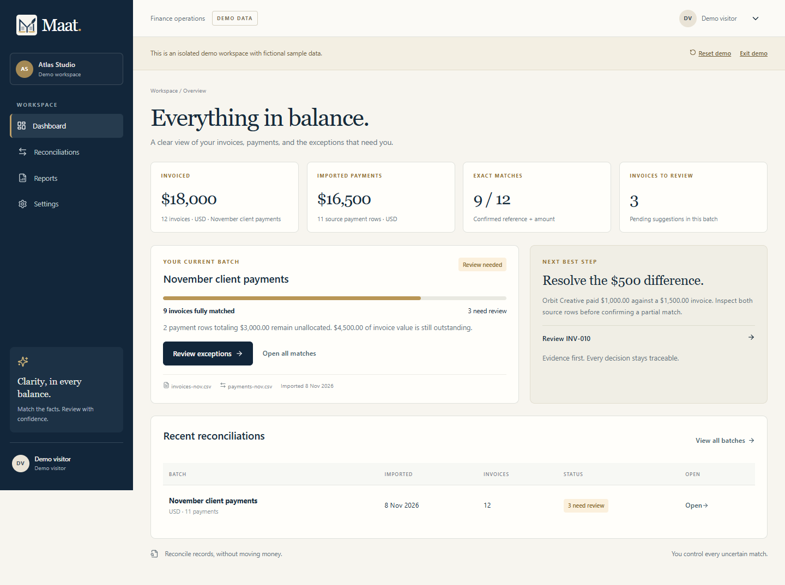

# Ma'at

**Know what's paid, what's missing, and why.**

Ma'at is a finance reconciliation workspace for small businesses and bookkeepers. It compares an
invoices CSV with a payments CSV, auto-allocates only unambiguous exact matches, explains every
exception with the original rows attached, records human decisions in an append-only audit trail,
and exports a reproducible report—including the items that remain unresolved.



## Status at a glance

| Area | State |
| --- | --- |
| Vertical workflow (upload → validate → match → review → export) | Implemented and exercised locally |
| Deterministic matching and financial invariants | Implemented; automated tests pass |
| SQLite persistence, private uploads, durable worker | Implemented; restart/retry tested |
| Privy server-side token verification | Implemented with JWKS; verified in unit tests with locally signed ES256 tokens |
| Privy email OTP browser login | **Verified with a real owner mailbox login**: verified Privy DID, local user, and owner workspace were created; production origin still needs dashboard configuration |
| Demo workspace isolation, reset, rate limit | Implemented; browser-tested |
| AI exception explanations | Fully implemented against an OpenAI-compatible API; **real provider inference not verified** because `AI_API_KEY` / `AI_MODEL` were not available. Tests use a local mock provider. Unconfigured mode is labelled plainly. |
| Vultr deployment | **Deployed and browser-verified** at `https://199-247-1-174.sslip.io`; Privy production origin and real AI provider remain separate items |

The deployment below was verified over HTTPS. No real-model response is fabricated.
See [Known limitations](KNOWN_LIMITATIONS.md).

## What works

- Named reconciliation batches with one currency per batch (USD in this MVP).
- Two-file CSV upload with column suggestions, previews, replace/remove, row-level validation, and
  downloadable sample files.
- Exact matching by normalized invoice reference + amount + currency, only when unique and
  unconsumed.
- Partial, ambiguous, overpayment, duplicate-reference, and unpaid exceptions. Suggestions never
  change totals.
- Real human review: confirm suggestion, choose another eligible payment, reject, leave unresolved,
  add a note, and undo through a new reversal event.
- Server-side balance checks, atomic writes, one active allocation per payment, and duplicate-submit
  protection.
- Durable job stages (`queued → validating → matching → explaining → completed/failed`), visible
  progress, retry, rerun, and safe recovery after a worker restart.
- AI explanation step with structured exception bundles, strict JSON validation, evidence-row
  allowlists, caching, bounded retry, and a rule-based fallback when unconfigured or failing.
- Invoice reconciliation CSV, unallocated payments CSV, decision history CSV, and a print-friendly
  HTML report using the browser's Save-as-PDF.
- Privy email OTP sign-in, first-use business setup, one owner workspace per verified identity,
  logout, settings, and append-only decision history.
- Isolated demo workspace with fictional data, personal-upload lockout, visitor-only reset, rate
  limiting, and 24-hour cleanup of abandoned demos.
- Responsive 1440 / 768 / 390 layouts, invoice cards on mobile, keyboard focus, 44px controls,
  loading/empty/error/offline states.

## Stack

- TypeScript, Next.js 15 App Router, React 19
- Small coherent CSS design system (no blocking external font requests)
- SQLite via `better-sqlite3` with ordered in-code migrations
- `csv-parse` for server-authoritative parsing, Papa Parse for client previews
- `jose` for Privy JWKS verification
- One Node worker polling the durable SQLite job table
- Privy (`@privy-io/react-auth`) for email OTP identity
- Optional OpenAI-compatible inference (Vultr Serverless Inference base URL by default)

## Quick start

Prerequisites: Node.js 22+ (tested on Node 24), pnpm 10+ via Corepack.

```bash
corepack enable
pnpm install
cp .env.example .env.local
# Generate a session secret on the host:
node -e "console.log(require('node:crypto').randomBytes(32).toString('hex'))"
# Put it in SESSION_SECRET in .env.local.
pnpm migrate
pnpm dev
```

`pnpm dev` runs the Next.js app on <http://localhost:3000> and the worker in watch mode. For
separate processes use `pnpm dev:web` and `pnpm dev:worker` (or `pnpm worker`).

Open <http://localhost:3000>, choose **Explore demo**, or sign in with email through Privy.

### Environment

See [`.env.example`](.env.example). Important values:

- `NEXT_PUBLIC_PRIVY_APP_ID` / `PRIVY_APP_ID` — public Privy application ID.
- `SESSION_SECRET` — server-only HMAC key for signed session cookies. Required.
- `DATABASE_URL` — SQLite file, outside `public/`.
- `UPLOAD_DIR` — private upload directory, outside `public/`.
- `APP_URL` — public origin without a trailing slash; controls Secure cookies and origin checks.
- `AI_BASE_URL`, `AI_API_KEY`, `AI_MODEL` — optional provider. When blank, explanations are labelled
  rule-based only.
- `UPLOAD_MAX_MB`, `CSV_MAX_ROWS` — server-enforced limits.

`NEXT_PUBLIC_*` values are compiled into the browser bundle. Never prefix secrets with
`NEXT_PUBLIC_`.

## Canonical sample and expected numbers

Download from the upload screen or directly:

- [`invoices-sample.csv`](public/samples/invoices-sample.csv)
- [`payments-sample.csv`](public/samples/payments-sample.csv)

Both contain 12 invoices of USD 1,500 (USD 18,000 total) and 11 payments (USD 16,500 total).

Before review:

- 9 exact allocations: USD 13,500
- invoice outstanding: USD 4,500
- 2 unallocated payment rows: P010 (USD 1,000 remaining) and P011 (USD 2,000) — USD 3,000
- 9 exact invoices; 1 partial, 1 unpaid, 1 ambiguous

After confirming P010's USD 1,000 partial allocation:

- confirmed allocations: USD 14,500
- invoice outstanding: USD 3,500
- 1 unallocated payment row: P011, USD 2,000
- P010 has zero remaining balance

## Matching rules

Exact auto-allocation requires all of:

1. exactly one invoice with the normalized reference,
2. exactly one unconsumed payment with that reference,
3. the same batch currency, and
4. an amount strictly equal to the invoice's outstanding amount.

Duplicate references, amount-only coincidences, similar names, and date proximity produce
suggestions only. They are never auto-confirmed. An unmatched invoice displays “No matched payment
in this batch”, not a claim that it is unpaid everywhere.

A payment can be allocated to at most one invoice in this MVP (partial allocations from multiple
payments settle one invoice through explicit review). Overpayments leave a visible unallocated
remainder. Suggestions never alter totals.

## Money and status semantics

- Money is stored and compared as integer minor units; no floating-point arithmetic.
- Invoice outstanding = invoiced − confirmed allocations.
- Unallocated payment = imported payment − confirmed allocations.
- Invoice status (`exact`, `partial`, `unpaid`, `ambiguous`, `settled`) is separate from review state
  (`needs_review`, `unresolved`, `confirmed`, `ready`).
- Accepted allocations and review events are written in one transaction. Undo adds a reversal event;
  it never deletes the original.
- Confirming a match is an accounting classification, not a bank transfer.

## Privy and workspace isolation

- Email OTP only. No password form, no wallet login, no automatic embedded wallets.
- Google is not displayed; enable it only if you also test and configure it in the Privy dashboard.
- Access tokens are verified server-side with Privy's public JWKS (`iss=privy.io`, `aud=app id`,
  `ES256`). A client-supplied user or workspace ID is never accepted as proof of access.
- The first verified login asks for a business name and creates one owner workspace in a
  transaction. Repeated sign-ins do not duplicate it.
- Optional identity-token support reads a verified email address when that Privy feature is enabled.
  Without it, Ma'at shows the verified Privy DID instead.
- Every batch, file, row, suggestion, allocation, decision, job, report, and download is scoped by
  authorized workspace membership. Cross-workspace access is covered by automated tests.
- Configure Privy allowed origins for `http://localhost:3000` and the actual production HTTPS origin.
  Do not guess the production domain.

## Demo privacy

The demo is a server-issued, signed-cookie session bound to its own workspace. Reset deletes only
that visitor's workspace and reseeds a fresh sample batch. Personal uploads are disabled. Demo records
expire after 24 hours and creation is rate-limited per hashed IP. Demo data is labelled in the UI and
report.

## AI explanations

`AI_BASE_URL` defaults to `https://api.vultrinference.com/v1`, but nothing is sent unless all three
of base URL, API key, and model are configured. Verify current model availability and account terms
before enabling.

- Only a small exception bundle is sent: normalized fields, candidate row IDs, computed differences,
  deterministic signals, and minimal source values. Never the whole CSV.
- The model returns validated JSON: explanation, evidence row IDs, suggested action, limitations.
  Unknown row IDs or invalid actions are rejected.
- The model cannot calculate amounts, mutate allocations, or send messages.
- Outputs are cached by bundle + provider + model + prompt version.
- If inference is unavailable, deterministic results remain and the UI says
  “AI explanation unavailable; showing rule-based evidence.”

The automated tests exercise success and failure paths with a local mock OpenAI-compatible server.
They are not evidence of a real provider run. See [Known limitations](KNOWN_LIMITATIONS.md).

## Persistence and exports

- SQLite in WAL mode with `busy_timeout`; migrations recorded in `schema_migrations`.
- Uploads live outside `public/` under random storage keys with restricted permissions.
- Exports are generated from current database state; invoice/confirmed/outstanding values are tested
  to match the database.
- CSV cells beginning with `= + - @`, tab, or carriage return are prefixed with an apostrophe to
  prevent spreadsheet formula injection.
- The printable report is HTML and uses the browser's print dialog. Ma'at does not claim to generate
  a PDF file server-side.

## Verification

Commands:

```bash
pnpm typecheck
pnpm lint
pnpm test          # Vitest unit + integration
pnpm build
pnpm test:e2e      # Playwright (Chrome channel; requires the app and worker)
```

Recorded results are in [VERIFICATION.md](VERIFICATION.md). Browser walkthroughs cover the Privy email modal, demo creation,
dashboard, workbench, evidence review, confirm, export download, undo, refresh persistence, mobile
overflow checks, real upload, validation errors, and cross-workspace denial. Actual screenshots are
in [`docs/screenshots`](docs/screenshots).

## Deployment

Production deployment guidance, systemd units, Caddy configuration, backups, and rollback are in
[DEPLOYMENT.md](DEPLOYMENT.md). The app is live on the reported Vultr VM at:

**https://199-247-1-174.sslip.io**

Health, landing page, demo creation, workbench, evidence review, and the canonical worker result were
verified over HTTPS. The hostname is a free `sslip.io` pointer to the VM, not a custom owner domain. If
a custom domain is added later, update `APP_URL`, Caddy, and Privy allowed origins.

## Known limitations

See [KNOWN_LIMITATIONS.md](KNOWN_LIMITATIONS.md). Highlights: real AI inference is not configured;
Privy production-origin login still needs the dashboard origin; USD only; no OCR, bank connections,
accounting integrations, FX, team invites, or money movement.

## Attribution

- Design references and approved logo: supplied `maat-design/` assets (Canva design DAHaU_bd1C4;
  approved logo DAHaRGvYfxQ).
- Icons: [Lucide](https://lucide.dev), ISC license.
- Fonts: system serif/sans stacks only; no external font requests.
- Privy, Next.js, SQLite, `csv-parse`, Papa Parse, `jose`, Vitest, Playwright and their respective
  licenses.

Ma'at is not a regulator, accounting firm, or payment processor. No certification or guaranteed
matching accuracy is claimed.

